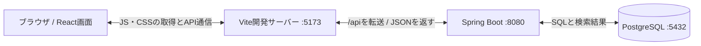

# Task Board — 個人向けタスク管理アプリ

タスクを「未着手・作業中・完了」の3列に分け、検索・閲覧できるWebアプリです。RaiseTechの学習課題として、画面設計からフロントエンド・API・データベースまでを実装しています。

Reactの画面からSpring BootのAPIを呼び出し、PostgreSQLに保存されたタスクを表示します。単一利用者・単一ボードを対象に、ローカル環境で動かします。

## 現在できること

- タスク一覧を進捗別の3列ボードに表示
- タイトルの部分一致検索とステータスによる絞り込み
- カードの優先度・期限・期限超過の表示と、詳細モーダルの閲覧
- 各列での優先度・期限の昇順／降順による並べ替え
- 読み込み中・0件・通信失敗の表示と再取得
- WebフォームからPOST APIを通じてタスクを新規登録し、DBへ保存
- APIによる一覧・検索・UUID指定の詳細取得

並べ替えは画面内のみで保持し、再読み込みで解除されます。追加モーダルから登録できます。新規タスクは未着手の末尾へ保存され、再読み込み後も取得できます。編集・削除、ドラッグ＆ドロップ、ソート条件・設定の永続化は今後の実装範囲です。

## 技術構成

| 領域 | 技術・使用バージョン |
|---|---|
| フロントエンド | React / React DOM 19.3.1、TypeScript 6.0.3 |
| 開発・スタイル・ルーティング | Vite 8.3.8、Tailwind CSS 4.3.5、React Router 8.5.1 |
| バックエンド | Java 25、Spring Boot 4.1.2、Gradle 9.8.2 |
| DB・永続化 | PostgreSQL 17、Spring Data JPA / Hibernate、Flyway |
| API通信 | Fetch API、REST / JSON |
| フロントエンドのテスト | Vitest、Testing Library、jsdom |
| バックエンドのテスト | Spring BootのHTTP統合テスト、実PostgreSQL |

バージョンの選定・維持理由と更新方針は[技術構成書](技術構成書.md)を参照してください。



Reactの画面処理はブラウザで動きます。Viteは開発用のファイル配信とAPI転送を担当します。検索時のデータの往復と各技術の役割は[学習メモ](学習メモ.md)で図解しています。

## 必要な環境

- Java 25：この環境で確認したJDKは25.0.5+8
- Node.js：`^22.22.2 || ^24.15.0 || >=26.0.0`、検証環境は26.7.0
- npm：検証環境は11.19.0
- DockerエンジンとDocker Compose：この環境ではDocker Desktopを使用
- Google Chrome：画面確認に使用

Gradleは同梱のWrapperを使用します。Nodeの検証バージョンは `frontend/.node-version` にも記載しています。JDKとNode.jsは各自の環境で用意してください。

## ローカルで起動する

DB → バックエンド → フロントエンドの順で起動します。以下の各手順は、元のプロジェクトディレクトリを起点に実行してください。バックエンドとフロントエンドには別のターミナルを使用します。

| 対象 | 接続先 |
|---|---|
| 画面 | <http://127.0.0.1:5173/> |
| API | <http://127.0.0.1:8080/api/tasks> |
| DB | `127.0.0.1:5432` |

標準ポートは固定です。競合時は別ポートに変更せず、起動元を特定して競合する他プロジェクトのローカルサービスを通常停止します。同じプロジェクトが正常起動済みなら再利用します。詳細は[統一起動スキル](skills/start-frontend-backend/SKILL.md)を参照してください。

### 1. DBを起動する

Docker DesktopなどのDockerエンジンを起動してから、プロジェクト直下で実行します。

```sh
sh scripts/setup-local-db.sh
DB_PORT=5432 docker compose up -d --wait db
docker compose ps db
```

セットアップはランダムなDBパスワードをGit対象外の `.env` に保存します。既存の `.env` は上書きしません。`.env`の内容や、認証情報が含まれる`docker compose config`の出力は共有しないでください。

### 2. バックエンドを起動する

Java 25を使うように `JAVA_HOME` と `PATH` を設定し、プロジェクト直下から実行します。

```sh
cd backend
java -version
DB_HOST=127.0.0.1 DB_PORT=5432 SERVER_PORT=8080 GRADLE_USER_HOME=/private/tmp/taskmanager-gradle ./gradlew bootRun --args='--server.address=127.0.0.1 --server.port=8080'
```

この環境に配置済みのJDKを使う場合の設定方法は[バックエンドREADME](backend/README.md)を参照してください。初回起動時は公開依存関係を取得します。FlywayによるDBスキーマの適用後、Hibernateがスキーマを検証します。

別ターミナルから確認します。

```sh
curl --fail --silent --max-time 5 http://127.0.0.1:8080/actuator/health
```

応答の `status` が `UP` であることを確認してから、次へ進みます。

### 3. フロントエンドを起動する

別のターミナルで、プロジェクト直下から実行します。

```sh
cd frontend
npm ci --ignore-scripts --no-audit --no-fund
TASK_API_TARGET=http://127.0.0.1:8080 npm run dev -- --host 127.0.0.1 --port 5173 --strictPort
```

Chromeで <http://127.0.0.1:5173/> を開いてください。依存関係がインストール済みでロックファイルも変わっていなければ、`npm ci`の再実行は不要です。

APIへのリクエストはViteの開発用プロキシからバックエンドへ転送します。フロントエンドへDBの認証情報を渡す必要はありません。

### 4. ボードを操作する

- 初回表示は全件取得です。カードを選ぶと詳細を表示します。
- 「＋ タスクを追加」でタイトル・説明・優先度・期限を入力して登録します。保存成功後は検索条件を解除して全件を再取得します。
- ボード下の「タスクを検索」を開き、タイトル・ステータスを指定して検索ボタンまたはEnterで検索します。
- クリアで条件をリセットし、再取得で最後に適用した条件を使って取得し直します。
- 列見出し下のボタンで、その列だけを並べ替えられます。期限なしは昇順・降順とも最後です。

DBが空の場合は空のボードになります。架空のデモデータが必要な場合は、[バックエンドREADMEの投入手順](backend/README.md#4-タスクread-api)を参照してください。通常起動ではサンプルを自動投入しません。

### 停止・再開

バックエンドとフロントエンドは、それぞれ実行中のターミナルでCtrl+Cを押して停止します。DBはプロジェクト直下で停止します。

```sh
docker compose stop db
```

DBのデータは名前付きボリュームに保持されます。再開は上記と同じ順序で行います。ボリューム削除は行わないでください。

## テスト・ビルド

### フロントエンド

プロジェクト直下から実行します。DBの起動は不要です。

```sh
cd frontend
npm test
npm run typecheck
npm run lint
npm run build
```

検索・取得失敗・古い応答の無視・列ごとの並べ替え・モーダルなどを自動テストで検証します。既存の確認結果は41件成功です。ブラウザ固有動作の未確認事項は[フロントエンドREADME](frontend/README.md)を参照してください。

ビルド結果は `frontend/dist/` に生成します。`npm run preview` は静的ビルドの確認用で、APIプロキシは設定していません。API連携の確認には開発サーバーを使用します。

### バックエンド

DBを起動し、Java 25の設定をしたターミナルで、プロジェクト直下から実行します。

```sh
cd backend
DB_HOST=127.0.0.1 DB_PORT=5432 GRADLE_USER_HOME=/private/tmp/taskmanager-gradle ./gradlew test bootJar
```

実PostgreSQLを使用してAPI・DBアクセスを確認し、JARを生成します。詳細と既存の確認結果は[バックエンドREADME](backend/README.md)を参照してください。

## ディレクトリ構成

```text
.
├── frontend/       React画面、APIクライアント、フロントエンドのテスト
├── backend/        Spring Boot、DBマイグレーション、HTTP統合テスト
├── prototype/      合意済み画面の確認用デモ
├── scripts/        ローカルDBの初期設定
├── skills/         統一起動スキルの正本
├── compose.yaml    PostgreSQLのローカル実行設定
└── *.md            要件・設計・受入条件・開発ルール
```

`prototype/` はlocalStorageを使う画面確認用デモです。実アプリの `frontend/` とはデータも保存方法も異なります。

## 関連文書

| 文書 | 内容 |
|---|---|
| [要件定義書](要件定義書.md) | 目的、対象範囲、前提条件 |
| [機能仕様書](機能仕様書.md) | 機能要件と操作ルール |
| [画面設計書](画面設計書.md) | 合意済みのレイアウトと画面仕様 |
| [データベース設計書](データベース設計書.md) | データ構造と設計方針 |
| [技術構成書](技術構成書.md) | 採用技術、バージョン、選定理由 |
| [受入条件](受入条件.md) | 初期版全体の受入条件 |
| [フロントエンドREADME](frontend/README.md) | 画面の操作、テスト、現在の実装範囲 |
| [バックエンドREADME](backend/README.md) | DB設定、API仕様、テスト |
| [学習メモ](学習メモ.md) | 検索からカード表示までの図解、全技術の役割と登場箇所 |
| [実装のポイント](frontend/実装のポイント.md) | フロントエンドのコード上の工夫と設計意図 |
| [統一起動スキル](skills/start-frontend-backend/SKILL.md) | 標準ポートでの起動と競合解消 |
| [Git運用](Git運用.md)・[実行方針](AGENTS.md) | Issue・ブランチ・コミット・PRのルール |

起動するにはこのREADME、全体を学ぶには学習メモ、個別の操作・API仕様にはfrontendとbackendのREADME、フロントの設計意図には実装のポイントを参照してください。

要件・設計・受入条件には今後の実装予定も含みます。現在利用できる機能は、このREADMEの「現在できること」と各実装のREADMEを参照してください。
