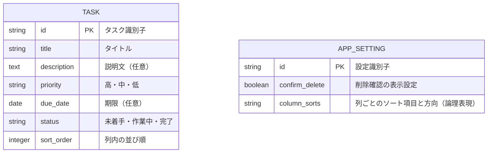

# 個人向けタスク管理アプリ データベース設計書

対象：初期版 ／ 更新日：2026年11月15日

[要件定義書に戻る](要件定義書.md)

DBはPostgreSQLを採用する。バックエンドからSpring Data JPA / Hibernateでアクセスし、スキーマの変更履歴はFlywayのSQLマイグレーションで管理する。採用技術の全体は[技術構成書](技術構成書.md)を参照する。

## 1. データ要件

### 1.1 タスクの項目

| 項目 | 内容 | 必須・初期値 |
|---|---|---|
| タイトル | タスクの名前 | 必須 |
| 説明文 | タスクの詳細。複数行の入力に対応する | 任意 |
| 優先度 | 高・中・低の3段階 | 必須。初期値は「中」 |
| 期限 | タスクの完了予定日。時刻は扱わない | 任意 |
| ステータス | 未着手・作業中・完了 | 必須。初期値は「未着手」 |

### 1.2 保存する管理情報

- 各列におけるカードの並び順（ソートまたはドラッグした結果を保持）
- 列ごとのソート条件（未選択、または優先度・期限と昇順・降順の組み合わせ）。初期値は未選択
- 削除確認を表示するかどうかの設定。初期状態では確認を表示する

タスクを識別する情報と並び順を保持する。具体的な型や制約は詳細設計で決定する。

## 2. ER図

単一ボード・単一利用者のため、ボードやユーザーのエンティティは設けない。TASKとAPP_SETTINGの間に直接の関連はない。設定はアプリ全体で1件とし、confirm_deleteの初期値は真とする。各タスクのstatusとsort_orderで列と列内順序を表す。属性の型・順序の管理方法・制約は論理的な表現であり、PostgreSQLに合わせて詳細設計で確定する。

## 3. 詳細設計で決める事項

- PostgreSQLで使用するカラムの型、長さ、NULL可否、制約、識別子の生成方式
- ステータス・優先度の格納値と初期値の実現方法
- 並び順の採番方法と、移動・並べ替え時の更新方法
- アプリ設定を1件に保つ方法
- 列ごとのソート条件（対象列・項目・方向）の物理的な格納形式
- ドラッグ時の並び順・ステータス・関係する列のソート解除を一括保存する方法
- タスク削除と確認設定変更を両方成功、または両方未反映にする保存処理

入力上の必須条件・初期値は第1章を正とし、操作ルールは[機能仕様書](機能仕様書.md)を参照する。採用技術は[技術構成書](技術構成書.md)を参照する。

## 4. デモとの対応

デモのtasks配列は現在のカード順序を表し、columnSortsはtodo（未着手）・doing（作業中）・done（完了）ごとに未選択（null）または項目（priority / dueDate）と方向（asc / desc）を保持する。本番の論理要件も同じとし、具体的な型・テーブル分割は詳細設計で決める。

ソートでは対象列の並び順と条件を、ドラッグでは移動元・移動先の並び順・ステータス・条件解除を整合した状態で保存する。保存失敗時はどの変更も確定しない。localStorageは画面確認用とし、実アプリではPostgreSQLに保存する。

## 5. 実装済みの物理定義

Docker ComposeでPostgreSQL 17を使用する。Flywayの `V1__create_tasks.sql` により `tasks` を作成する。

| カラム | PostgreSQL型・制約 |
|---|---|
| id | UUID、主キー。呼び出し元で生成する |
| title | VARCHAR(255)、NOT NULL、空白のみを禁止 |
| description | TEXT、NULL可 |
| priority | VARCHAR(10)、NOT NULL、high / medium / low、初期値medium |
| due_date | DATE、NULL可 |
| status | VARCHAR(10)、NOT NULL、todo / doing / done、初期値todo |
| sort_order | INTEGER、NOT NULL、0以上、初期値0 |

`(status, sort_order)` にインデックスを設ける。同じ並び順は許可し、採番・並べ替え処理は今後実装する。タスクのJPAエンティティとREAD APIは実装済み。APP_SETTINGは未実装。起動・接続手順は[バックエンドREADME](backend/README.md)を参照する。
