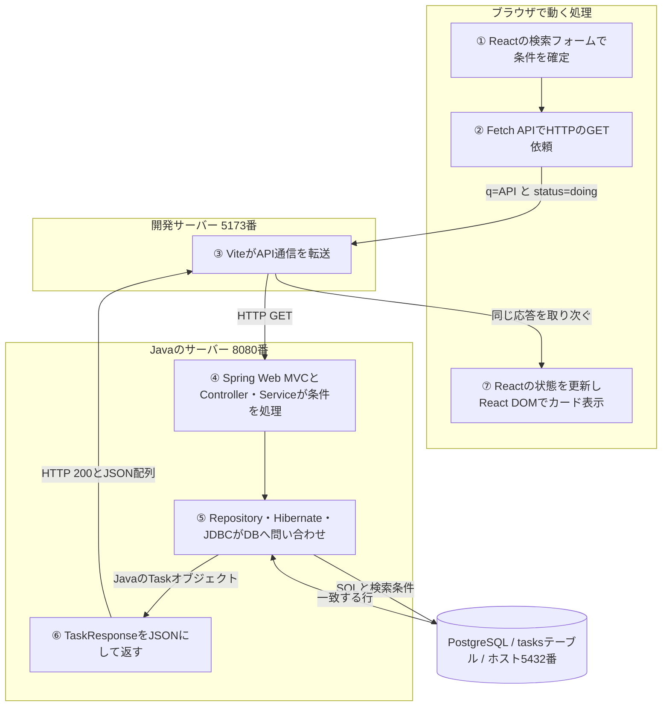
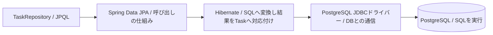
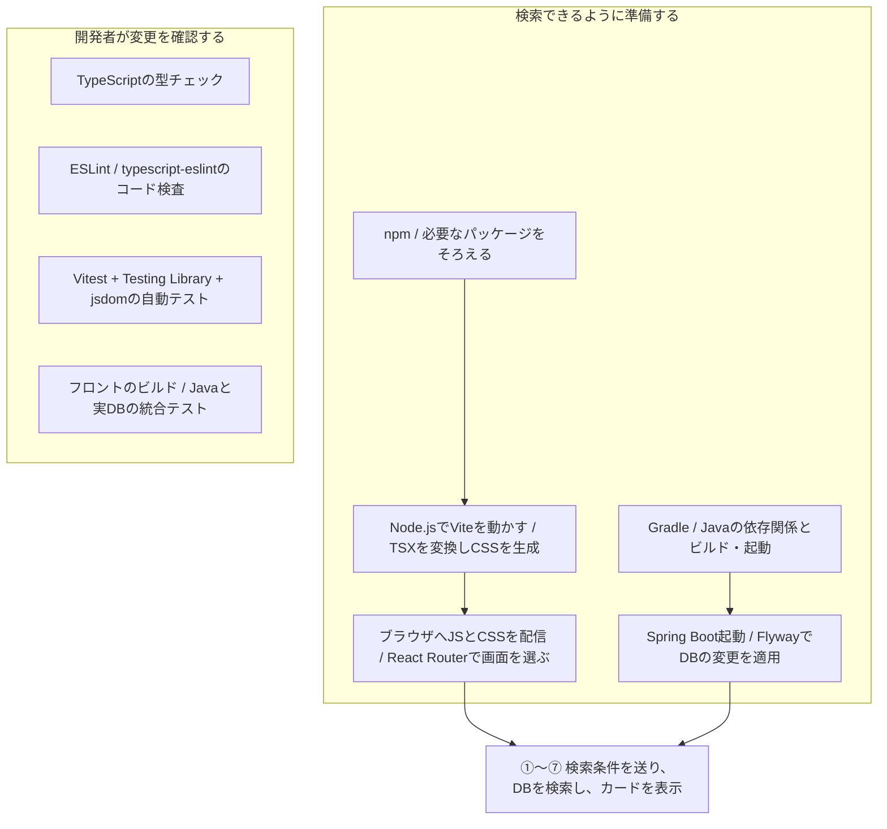

# 学習メモ — 検索ボタンからカード表示まで

更新日：2026年11月17日

この資料は、今回作ったアプリの「なぜ・どこで・何が動くか」を理解するためのものです。起動コマンドは[ルートREADME](README.md)、バージョンの正確な指定と維持理由は[技術構成書](技術構成書.md)を参照してください。

まず1〜4章でデータの往復をつかみ、次に5章で技術名を対応させ、最後に7章のコードを追ってみてください。例に登場するタスクは架空です。

## 1. 最初に知っておきたい3つの担当

| 担当 | 平易な説明 | このアプリで動く場所 |
|---|---|---|
| フロントエンド | 入力を受け取り、結果を画面に並べる係 | Chromeなどのブラウザ |
| バックエンド | 条件を確認し、DBに検索を頼み、必要な項目を返す係 | Javaで動くSpring Bootのサーバー、8080番 |
| データベース（DB） | タスクを表の形で保管し、検索する係 | Docker内のPostgreSQL、ホストからは5432番で接続 |

今回は全部同じPCで動かしますが、別々のプログラムです。`127.0.0.1`は自分のPCを指し、ポート番号はその中の接続先を区別します。5173番は開発用のViteサーバーです。Viteは画面のプログラムをブラウザへ渡し、API通信をバックエンドへ取り次ぎます。

**Reactの画面処理はブラウザで動きます。ViteとNode.jsは、今回の構成では開発サーバーやビルドを動かす側です。**

### 言語・道具・データ形式の違い

| 分類 | 例 | 役割 |
|---|---|---|
| プログラムを書く言語 | TypeScript、Java | 何を処理するかを記述する |
| ブラウザが実行する言語 | JavaScript | TypeScript・TSXから変換された画面の処理を実行する |
| 画面の構造・見た目 | HTML、CSS、TSX | HTMLは画面構造、CSSは装飾、TSXはTypeScriptの中でReactの画面構造を書く形式 |
| DBへの問い合わせ言語 | SQL | PostgreSQLに、どの行を取り出すかなどを伝える |
| アプリ作りの道具 | React、Spring Bootなど | 画面更新・HTTP受付などの仕組みを提供する |
| 通信の規則・データ形式 | HTTP、JSON | HTTPは依頼・返答の通信方法、JSONは返すデータの書き方 |

ReactやSpring Bootは言語名ではありません。TypeScriptの型は開発時の確認に使われ、ブラウザへ送られるJavaScriptでは型注釈が取り除かれます。型があるだけでAPIの実データまで正しくなるわけではないので、受信時にも形式を確認しています。

## 2. 全体の図 — 条件が出て、データが帰ってくる

例として、タイトルに「API」を含み、ステータスが「作業中」のタスクを検索します。



送るのは検索条件で、戻るのはタスクのデータです。サーバーから完成したカードのHTMLが返るのではありません。受け取ったデータをどの列に、どんな色や文字で表示するかはフロントエンドが決めます。

## 3. 7つの段階を順番に見る

### ① 入力中の条件を「検索する条件」にする

[App.tsx](frontend/src/App.tsx)には、入力途中の`draft`と、検索を実行した`conditions`があります。入力だけではAPIへ送りません。検索ボタンまたはEnterでフォームを送信すると、ページ全体の再読み込みを防いで`conditions`を更新します。

```text
画面の入力：タイトル「 API 」 / ステータス「作業中」
確定した条件：q = "API" / status = "doing"
```

`q`は検索語のパラメーター名、`doing`は「作業中」を表す内部の値です。前後の空白を除去します。条件が変わると[useTasks.ts](frontend/src/hooks/useTasks.ts)が取得を始め、読み込み中の表示に切り替えます。

### ② ブラウザがAPIへ依頼する

[api/tasks.ts](frontend/src/api/tasks.ts)の`fetchTasks`がURLを作り、ブラウザ標準の`fetch`で依頼します。

```http
GET /api/tasks?q=API&status=doing
Accept: application/json
```

| 依頼の要素 | 意味 |
|---|---|
| `GET` | データの取得を依頼するHTTPメソッド |
| `/api/tasks` | タスク一覧を扱う受付の場所（エンドポイント） |
| `?q=API&status=doing` | URLに付けた検索条件（クエリパラメーター） |
| `Accept: application/json` | JSON形式の返答を受け取りたいという指定 |

この検索ではJSONのリクエスト本文は送りません。DBのパスワードも送りません。日本語や`&`などを正しく条件として渡すため、`URLSearchParams`でURL用の表現に変換します。「すべて」の場合は`status`を省略し、検索語が空なら`q`を省略します。

### ③ Viteが8080番へ取り次ぐ

ブラウザは相対パス`/api/tasks`を、現在の画面と同じ`127.0.0.1:5173`へ送ります。[vite.config.ts](frontend/vite.config.ts)のプロキシ設定により、Viteが次へ転送します。

```text
ブラウザ → http://127.0.0.1:5173/api/tasks?q=API&status=doing
Vite     → http://127.0.0.1:8080/api/tasks?q=API&status=doing
```

プロキシは「取り次ぎ役」です。ブラウザから見た通信先を画面と同じ接続先に保てます。別ポートへブラウザから直接通信する場合に必要になるCORS（別の接続元からのアクセスに関する許可）の設定を、今回のブラウザ向けAPI通信では必要としていません。これは開発用の構成で、外部公開時の構成は今回の対象外です。

### ④ Java側で条件を受け取り、役割ごとに処理する

バックエンドはSpring Bootで起動し、Spring Web MVCがHTTPリクエストを対応するControllerへ渡します。

| クラス・仕組み | 今回の担当 |
|---|---|
| Spring Web MVC | URLとHTTPメソッドを見て受付を選び、パラメーターや応答を扱う |
| `TaskController` | `status`が`todo / doing / done`かを確認し、Serviceへ依頼する |
| `TaskService` | 検索語の前後の空白を除き、Repositoryの検索を呼ぶ |
| `TaskRepository` | DBからどのタスクをどの順序で取得するかを宣言する |

分ける理由は、HTTPの受付、処理の段取り、DB操作をそれぞれ見つけやすくするためです。別々のサーバーへ移動するわけではなく、同じJavaアプリ内での呼び出しです。

### ⑤ Javaの問い合わせをDBへ伝える

`TaskRepository`はSpring Data JPAを使い、`@Query`に検索条件を書いています。ここに書かれているのは**JPQL**というJavaのエンティティを対象にした問い合わせで、そのままPostgreSQLへ送るSQLではありません。



- JPAは、JavaのオブジェクトとDBの表を対応付けるための共通の仕様です。
- Hibernateは、この構成でJPAの働きを実際に行う実装です。
- Spring Data JPAは、その仕組みを使うRepositoryを少ない記述で用意する道具です。
- JDBCドライバーは、Java側からPostgreSQLに接続し、問い合わせや結果をやり取りするための部品です。

SQLの意味を学ぶために、今回の条件を簡略化すると次のようになります。これは**理解用の例**であり、Hibernateが実際に生成したSQLを転記したものではありません。

```sql
SELECT *
FROM tasks
WHERE status = 'doing'
  AND POSITION('api' IN LOWER(title)) > 0;
```

実装のJPQLは`locate`と`lower`を使い、タイトルの部分一致を大文字小文字の区別なく調べます。上のSQL例では、文字の出現位置を調べる`POSITION`でその意味を示しています。説明文は検索しません。`%`や`_`も普通の文字として探します。実装では値をパラメーターとして渡し、ユーザー入力をSQL文字列へ直接つなぎません。

実際の並び順は`todo → doing → done`、列内で`sortOrder`昇順、同順位でUUID昇順です。`TaskService`は読み取り専用のトランザクション内で検索します。検索操作はタスクを書き換えません。

### ⑥ Javaの結果をJSONにして返す

DBの行はHibernateによって[Task.java](backend/src/main/java/com/example/taskmanager/task/Task.java)のオブジェクトに対応付けられます。Serviceが各Taskを[TaskResponse](backend/src/main/java/com/example/taskmanager/task/TaskResponse.java)へ変換し、Spring Web MVC側のJSON変換処理を通じて返します。

返答の例：HTTPステータス`200`と、次のようなJSON配列です。

```json
[
  {
    "id": "00000000-0000-4000-8000-000000000003",
    "title": "API取得を検証する",
    "description": "架空の検証用タスク",
    "priority": "high",
    "dueDate": "2026-11-21",
    "status": "doing",
    "sortOrder": 0
  }
]
```

| 項目 | 意味・画面での使い方 |
|---|---|
| `id` | タスクを区別するUUID。Reactでもカードを識別するkeyに使う |
| `title` | カードのタイトル |
| `description` | 詳細モーダルの説明文。未設定なら`null` |
| `priority` | `high / medium / low`を「高・中・低」と色へ変換する |
| `dueDate` | 時刻を含まない日付。未設定なら`null`、画面では「期限なし」 |
| `status` | `todo / doing / done`に応じて表示先の列を決める |
| `sortOrder` | DBにある列内の順序。APIの並び順に反映される |

`[]`は「0件の正常な結果」です。`null`は「その項目に値がない」という意味で、0件とは別です。DBの接続情報やJavaのクラスそのものを送っているわけではありません。

### ⑦ JSONのデータからカードを表示する

1. `fetchTasks`がHTTPの成功・失敗を確認し、`response.json()`でJSONをJavaScriptの配列・オブジェクトとして読み取る。
2. 配列であることや必須項目・値の種類を確認してから`useTasks`へ渡す。
3. `useTasks`が`tasks`・`loading`・`error`というReactの状態を更新する。
4. `App`がデータを`TaskBoard`へ渡し、列ごとにタスクを振り分ける。
5. `TaskCard`が1件のタイトル・優先度・期限を表示する構造を作る。
6. React DOMがブラウザのDOM（画面構造）を更新し、CSSが色・余白などを与える。

Tailwindと補助CSSで作ったスタイルが見た目を整えます。検索のたびにCSSを作り直すわけではありません。DBはカードの色やHTMLを決めていません。

初期状態ではAPIの順序を保ちます。列のソートボタンを選択した場合は、受信したデータをフロント内で並べ替えて表示します。このソートや詳細モーダルの表示は新しいAPI呼び出しを行わず、取得済みのデータを使います。詳細取得API自体は存在しますが、現在のカード選択では呼びません。

## 4. 正常・0件・失敗・待ち時間を区別する

| 状況 | 応答・検出 | 画面の扱い |
|---|---|---|
| 条件に合うタスクがある | HTTP 200と配列 | 各列へカードを表示 |
| 条件に合うタスクがない | HTTP 200と`[]` | 該当なしを表示。エラーではない |
| 不正なstatusを直接APIへ送る | HTTP 400 | 条件を確認するよう案内。通常の画面では選択肢に限定している |
| API停止など | 通信エラー、プロキシのエラー応答など | 取得失敗と再取得の案内。0件として扱わない |
| 応答に10秒以上かかる | AbortControllerで中断 | タイムアウトと再取得の案内 |
| 前の検索の応答が後から届く | 通信を中断し、有効な検索かも確認 | 古い結果で最新の画面を上書きしない |

再取得は最後に適用した条件でやり直します。別の検索を始めても、DBの元データが消えるわけではありません。検索条件は保存されず、画面を再読み込みすると全件取得に戻ります。

## 5. 技術構成書1.1の技術は、いつ登場する？

すべての道具が検索ボタンを押すたびに動くわけではありません。次の図で「準備」「検索中」「開発時の確認」を分けると整理できます。



「必要」とは、この構成で担当している役割があるという意味です。他のアプリでも必ず同じ製品を使う、という意味ではありません。以下は[技術構成書1.1](技術構成書.md)の全20項目との対応です。

| 技術 | 何をするためのもの？ | 図のどこに登場する？・このアプリとの対応 |
|---|---|---|
| Java | バックエンドの処理を書く言語。JDKはコンパイル・実行の道具を含む | ④〜⑥。Controller・Service・TaskなどをJavaで書く |
| Spring Boot | WebサーバーやDB接続などを設定してJavaアプリを起動・構成する土台 | 準備と④〜⑥。[TaskManagerApplication](backend/src/main/java/com/example/taskmanager/TaskManagerApplication.java)、application.properties |
| Gradle | Java側のライブラリ取得、コンパイル、テスト、起動を管理する | 準備・確認。[build.gradle](backend/build.gradle)、gradlew。検索ごとにビルドはしない |
| Spring Web MVC | HTTPの受付、引数の受け取り、返答の変換を担当する | ④・⑥。TaskControllerのURLと処理をつなぎ、結果をJSONで返す |
| Spring Data JPA / Hibernate | Repositoryの呼び出しを実現し、JavaのデータとDBの表を結び付ける | ⑤とDBからの戻り。TaskRepositoryとTaskのマッピングを使う |
| Flyway | DBの表の変更をSQLファイルの履歴として順に適用する | 準備。[V1__create_tasks.sql](backend/src/main/resources/db/migration/V1__create_tasks.sql)でtasksを作る。検索ごとには実行しない |
| PostgreSQL JDBC | JavaとPostgreSQLの通信を可能にするドライバー | ⑤。接続設定に従い、SQLや値と結果をやり取りする |
| PostgreSQL | データを保管し、SQLを実行して条件に合う行を返す | ⑤のDB。Docker内のtasksテーブル |
| React / React DOM | Reactは画面を部品と状態で記述し、React DOMはそれをブラウザの画面構造へ反映する | ①・⑦。App・TaskBoard・TaskCard、main.tsxのcreateRoot |
| TypeScript | 型を付けて画面や取得処理を書き、型の間違いを開発時に見つける | 準備・確認と①②⑦のソース。ブラウザ実行時にはJavaScriptになる |
| Vite | 開発サーバー、TSXの変換、APIプロキシ、配布用ビルドを担当する | 準備・③・確認。Viteの変換だけでは型チェック完了にはならない |
| Tailwind CSS / Viteプラグイン | ユーティリティクラス用のCSSを生成し、画面の見た目を整える | 準備で生成し⑦で見た目に反映。今回のデモ由来の補助CSSもstyles.cssに併用 |
| React Router | ブラウザのURLに対応する画面を選ぶ | 準備の画面表示。main.tsxの `/` と未定義URL。検索条件の送信は担当しない |
| Node.js | ViteやテストなどのJavaScript開発ツールをPC上で動かす実行環境 | 準備・③・確認。JavaのバックエンドやブラウザのReactを実行するものではない |
| npm | フロントのパッケージをそろえ、package.jsonに書いたコマンドを呼ぶ | 準備・確認。npm ci、npm run dev、npm test。検索ごとにインストールしない |
| ESLint / typescript-eslint | コードの規則違反や問題のある書き方を調べ、TypeScriptの構文をLintで扱う | 確認。eslint.config.jsとnpm run lint。API通信の途中には入らない |
| Vitest | テストを実行し、期待どおりか判定する枠組み | 確認。検索条件・並べ替え・エラー・モーダルなどのテストを実行 |
| jsdom | Node.js内にブラウザに似たDOM環境を用意する | 確認。実Chromeではなく、CSSの見た目や全ブラウザ機能を再現するものでもない |
| Testing Library | React画面の部品を描画し、要素を探し、操作と結果を確認する | 確認。React版が描画・要素取得、user-eventが入力やクリック、jest-domが表示・無効状態などの検証を助ける |
| Fetch API / REST API | FetchはHTTP通信のブラウザ標準機能、REST APIはタスクなどの資源をURLとHTTPメソッドで扱う設計 | ②〜⑥。GET /api/tasksで条件を渡しJSONを受け取る。REST自体は言語やインストールする製品ではない |

### DockerとFlywayはどう違う？

Docker / Composeは1.1の20項目の外ですが、今回のDBを動かすために使っています。[compose.yaml](compose.yaml)がPostgreSQLのコンテナ、ポート、データを保持するボリュームを定義します。Flywayは、その起動したDBの中に表を作ったり変更したりする係です。

DockerがDBを起動しても、表の構造は別に必要です。逆にFlywayだけでDBサーバー自体が起動するわけでもありません。Hibernateは今回`validate`設定なので、Flywayが適用した表とエンティティの整合性を確認します。

### ビルドとは？

ソースを実行・配布に使える形へまとめる作業です。フロントの`npm run build`は型チェックの後にViteでJS・CSSなどを`dist/`へ出力します。Java側の`bootJar`はコンパイルされたクラスと必要なライブラリを実行可能なJARへまとめます。ソースを変更した後の開発サーバーの変換と、配布用のビルドは区別してください。

## 6. 「検索」と似ているけれど違う操作

| 操作 | 今の動作 |
|---|---|
| 初回表示 | 検索ボタンなしでGET /api/tasksを実行し、全件取得 |
| 検索 | タイトルとステータスをAPIへ送り、DBで条件を絞る |
| 列のソート | 取得済みのデータをブラウザ内だけで並べ替える |
| カード選択 | 取得済みの説明文などを詳細モーダルへ表示する |
| 追加・編集・削除 | 新規追加・編集・ドラッグ移動はAPIでDB保存。削除はDELETE APIで対象行を物理削除。確認省略チェックと設定は削除と同時にDBへ保存 |

一覧APIは説明文を含めて返すので、今は詳細モーダルを開く際の再通信が不要です。将来一覧の返す項目を減らすなどの変更をした場合は、詳細APIの利用を検討することになります。

## 7. 実際のファイルを追う順番

| 順番 | ファイル | 見つけたい処理 |
|---|---|---|
| 1 | [App.tsx](frontend/src/App.tsx) | search、draftとconditions、TaskBoardへの受け渡し |
| 2 | [useTasks.ts](frontend/src/hooks/useTasks.ts) | useEffect、読み込み状態、通信中断と10秒の制限 |
| 3 | [api/tasks.ts](frontend/src/api/tasks.ts) | URLSearchParams、fetch、response.json、isTask |
| 4 | [vite.config.ts](frontend/vite.config.ts) | `/api`の転送先 |
| 5 | [TaskController.java](backend/src/main/java/com/example/taskmanager/task/TaskController.java) | @GetMappingとstatusの検証 |
| 6 | [TaskService.java](backend/src/main/java/com/example/taskmanager/task/TaskService.java) | strip、repository.search、responseへの変換 |
| 7 | [TaskRepository.java](backend/src/main/java/com/example/taskmanager/task/TaskRepository.java) | @Query、locate、lower、order by |
| 8 | [Task.java](backend/src/main/java/com/example/taskmanager/task/Task.java)・[TaskResponse.java](backend/src/main/java/com/example/taskmanager/task/TaskResponse.java) | DBとの対応、返す7項目 |
| 9 | [TaskBoard.tsx](frontend/src/components/TaskBoard.tsx) | statusごとのfilter、表示中のソート |
| 10 | [TaskCard.tsx](frontend/src/components/TaskCard.tsx)・[styles.css](frontend/src/styles.css) | タイトル・優先度・期限と装飾 |

コードを一度に全部理解する必要はありません。最初は「どんな値を受け取り、どこへ何を渡すか」を探してみてください。

## 8. 自分の言葉で説明するための確認メモ

- 検索時に送るのは、タスク全件・SQL・検索条件のうちどれ？ → 検索条件。SQLはバックエンド側からDBへ送る。
- JSONにカードの緑色や余白は入っている？ → 入っていない。画面のコードとCSSが決める。
- 検索のたびにFlywayが表を作る？ → 作らない。起動時に未適用の変更を適用する。
- Node.jsはJavaのAPIサーバー？ → 違う。今回のAPIサーバーはJava / Spring Boot。
- 0件なら通信に失敗した？ → HTTP 200と`[]`なら正常。
- 型チェックが通ればAPI応答の中身も保証される？ → 保証されない。実データの形式確認も必要。
- 列ソートを変えたらDBの順序も変わる？ → 今はブラウザ内だけ。保存APIは呼ばない。

分からない箇所は「③のプロキシがなかったら、何が変わる？」「⑤のHibernateを使わない場合、何を自分で書く？」のように、段階番号と具体的な疑問を組み合わせて質問すると理解をつなげやすくなります。

## 新規登録の流れ（Issue #11）

追加フォーム → FetchでPOST /api/tasksへJSON送信 → Controller → Serviceで入力確認・未着手末尾の採番 → Repositoryで保存 → PostgreSQLへコミット → 201 Created → フォームを閉じ、検索条件を解除して一覧を再取得、の順に処理します。DBに保存するので画面を再読み込みしても新しいタスクを取得できます。列の優先度・期限ソート条件の永続化は別作業です。

編集とドラッグ移動の現在の操作・制限は[フロントエンドREADME](frontend/README.md)、PUT・PATCHの仕様は[バックエンドREADME](backend/README.md)を参照してください。
