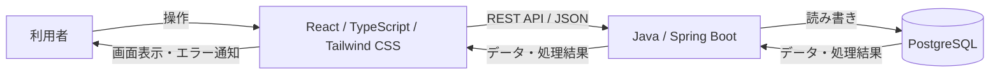

# 個人向けタスク管理アプリ 技術構成書

対象：初期版 ／ 更新日：2026年11月17日

[要件定義書に戻る](要件定義書.md)

## 1. 採用する技術スタック

初期版はReactのフロントエンド、Java / Spring Bootのバックエンド、PostgreSQLのデータベースで構成する。

| 用途 | 採用技術 | 役割・採用理由 |
|---|---|---|
| バックエンド言語 | Java | Spring BootでAPIと業務処理を実装する |
| バックエンドフレームワーク | Spring Boot | API、業務処理、DBアクセスを構成する |
| バックエンドのビルド | Gradle | Javaの依存関係とビルドを管理する |
| API | Spring Web / REST API | HTTPでJSON形式のデータをやり取りする |
| DB操作 | Spring Data JPA / Hibernate | JavaのエンティティとDBのデータを対応付ける |
| DBの変更管理 | Flyway | テーブル定義の変更をSQLで履歴管理する |
| データベース | PostgreSQL | タスク、並び順、各列のソート条件、削除確認設定を永続化する |
| フロントエンド言語 | TypeScript | 型チェックを利用して画面と操作を実装する |
| フロントエンドライブラリ | React | ボード、カード、モーダルをコンポーネントで構成する |
| フロントエンドの開発・ビルド | Vite | React / TypeScriptの開発環境とビルドに使用する |
| スタイリング | Tailwind CSS | ユーティリティクラスを使って画面の見た目を実装する |
| 画面遷移 | React Router | フロントエンドのルーティングを扱う。現在はボードと未定義URLを扱い、モーダルはURLを変更せず画面内状態で管理する |
| API通信 | Fetch API | ブラウザ標準の機能でバックエンドと通信する |

主に使用する言語はJava・TypeScript・CSS・SQLとする。Reactの画面構造はTSXで記述する。Next.jsは今回の対象外とし、バックエンドのビルドにはMavenではなくGradleを使用する。スタイリングはTailwind CSSを基本とし、必要な補助スタイルは通常のCSSで記述する。

バックエンドのひな型はJava 25 LTS / Spring Boot 4.1.2 / Gradle 9.8.2で構成し、GradleのビルドスクリプトにはGroovy DSLを使用する。Gradleの確認手順、ローカルの起動・停止方法、初期設定の範囲は[バックエンドREADME](backend/README.md)を参照する。各技術のバージョンと現在の採用・維持理由は次節に記載する。フロントエンドのパッケージ管理にはnpmを使用する。

### 1.1 使用バージョンと採用・維持理由

2026年11月17日時点の構成を示す。導入時に理由が記録されていなかったものは当時の判断を推測せず、現在このバージョンを採用・維持する理由を記載する。

| 技術 | 使用バージョン・指定方法 | 採用・維持理由 |
|---|---|---|
| Java | メジャー25指定、使用JDK 25.0.5+8 | 既存バックエンドのJava 25ツールチェーンと動作確認済みのJDKにそろえるため。 |
| Spring Boot | 4.1.2固定 | 既存READ APIとPostgreSQLの統合テストを確認した構成を維持するため。 |
| Gradle | Wrapperで9.8.2固定 | Java 25・Spring Boot 4.1.2で確認済みのビルドを再現するため。 |
| Spring Web MVC | Boot管理、既存JARでは7.0.10 | Boot管理の依存関係にそろえ、個別のバージョン差による不整合を避けるため。 |
| Spring Data JPA / Hibernate | Boot管理、既存JARでは4.1.2 / 7.4.13.Final | Boot管理の組み合わせで既存エンティティとDBアクセスを維持するため。 |
| Flyway | Boot管理、既存JARでは12.4.0 | PostgreSQL用モジュールと同じ版を使い、既存のスキーマ移行を維持するため。 |
| PostgreSQL JDBC | Boot管理、既存JARでは42.7.14 | Boot管理のドライバーで確認済みのDB接続を維持するため。 |
| PostgreSQL | Composeでメジャー17指定 | 既存DB・Flyway・実DBテストで使用しているメジャーを維持するため。 |
| React / React DOM | 19.3.1固定 | 両方の版をそろえ、コンポーネントと操作テストで確認済みの構成を維持するため。 |
| TypeScript | 6.0.3固定 | 最新安定版7.0.2は最新typescript-eslintの対応範囲外のため、対応範囲内の現行版を維持するため。 |
| Vite | 8.3.8固定 | 現在のReact・Tailwind連携とローカルAPIプロキシを構成した版を維持するため。 |
| Tailwind CSS / Viteプラグイン | 両方4.3.5固定 | 本体とプラグインの版をそろえ、既存画面のCSS生成を維持するため。 |
| React Router | 8.5.1固定 | 現在のボードと未定義URLのルーティングを構成した版を維持するため。 |
| Node.js | 検証環境26.7.0、許容範囲はpackage.jsonに記載 | Vite・Vitest・jsdomの実行要件を満たす確認済みの環境にそろえるため。 |
| npm | 検証環境11.19.0 | package-lock.jsonを作成した環境にそろえ、依存関係の再現性を保つため。 |
| ESLint / typescript-eslint | 10.15.0 / 8.72.2固定 | ESLintとTypeScriptがともに公式peerDependenciesの対応範囲に入る組み合わせを維持するため。 |
| Vitest | 5.1.0固定 | Vite 8に対応する版で検索・ボタン・モーダルの自動テストを実行するため。 |
| jsdom | 31.0.1固定 | 現在のVitest環境でDOM操作のテストを再現するため。 |
| Testing Library | React 16.3.3 / user-event 14.6.12 / jest-dom 7.0.1固定 | 画面部品・利用者の操作・表示の検証を現在のテスト環境にそろえるため。 |
| Fetch API / REST API | ブラウザ標準API・通信方式のためパッケージ版なし | 通信ライブラリを追加せず、ブラウザ標準の機能で既存APIへ接続するため。 |

フロントエンドの依存関係は[package.json](frontend/package.json)と`package-lock.json`、バックエンドは[build.gradle](backend/build.gradle)とGradle Wrapper、DBは[compose.yaml](compose.yaml)を正とする。PostgreSQLの`postgres:17`はメジャータグであり、パッチ版やイメージdigestまでは固定していない。Spring Boot管理のライブラリは個別に上書きせず、上表の細かい番号は既存ビルド済みJARで確認した値として扱う。

### 1.2 TypeScriptの更新判断と更新方針

2026年11月17日、公開npmレジストリの[TypeScript最新安定版](https://registry.npmjs.org/typescript/latest)は7.0.2だった。一方、[typescript-eslintの公式対応範囲](https://typescript-eslint.io/users/dependency-versions/)と最新8.72.2のpeerDependenciesは`>=4.8.4 <6.1.0`であり、7系は範囲外だった。そのため、今回の更新判断ではTypeScript 6.0.3を維持する。これは現在確認できた維持理由であり、導入当時に互換性を比較して6系を選んだという意味ではない。

typescript-eslintが7系を正式にサポートした段階で再評価する。`--force`や`--legacy-peer-deps`で制約を無視した更新、Lintを外しての更新は行わない。更新時は型チェック・Lint・自動テスト・ビルドを確認し、採用番号と理由も更新する。「常に最新版」ではなく、関連ツールの対応範囲を満たし確認できた版を使う。

## 2. システム構成とデータフロー

現在は起動時にタスク一覧を取得し、APIが返す列内順序で表示する。設定取得・編集・削除の保存は未実装。タスク新規登録はPOST APIで保存する。初期版の目標として、追加・編集・削除・移動時は変更をバックエンドへ送り、保存結果を画面に反映する。APIはREST形式とし、リクエスト・レスポンスはJSONで扱う。READ APIのエンドポイント・データ形式・HTTPステータスはバックエンドREADMEに記載済み。取得失敗時の再取得は実装済みで、書き込みAPIと保存失敗時の処理は今後確定する。

## 3. 実装・実行時の前提

単一利用者・単一ボードを対象とし、認証や複数人での同時利用は初期版の対象外とする。対応環境・性能などの条件は[要件定義書](要件定義書.md)を、データ構造は[データベース設計書](データベース設計書.md)を参照する。

開発・動作確認はローカル環境で行う。外部ホスティング、デプロイ、外部へのデータ送信、有料サービスの利用は行わない。ローカルの起動構成・標準ポート・接続設定は第6章と[統一起動スキル](skills/start-frontend-backend/SKILL.md)に従う。

## 4. 合意済みの画面プロトタイプ

[prototype/index.html](prototype/index.html)を画面仕様の参照実装とする。デモはHTML・CSS・JavaScriptのみで構成し、外部ライブラリ・外部フォント・外部通信を使用しない。localStorageでタスク、列内順序、列ごとのソート条件、削除確認設定を保持する。

HTML・CSS・JavaScriptとlocalStorageによる構成はデモ専用とする。実アプリには第1章の採用技術と第2章の構成を適用し、合意した画面仕様をReactとTailwind CSSで実装する。デモの検証メニューや保存方式と、本番の機能要件を区別する。起動方法と制限は[デモREADME](prototype/README.md)を参照する。

## 5. バックエンド初期設定の状態

Java 25 LTS / Spring Boot 4.1.2 / Gradle、Docker ComposeによるPostgreSQL 17を使用する。Flywayでtasksテーブルを作成し、JPAエンティティとタスク一覧・検索・詳細のREAD APIを実装済み。起動とAPIの仕様は[バックエンドREADME](backend/README.md)を参照する。POSTによる新規登録を実装済み。更新・削除APIとアプリ設定の永続化は今後の対象とする。

## 6. 検索・閲覧フロントエンド

`frontend/` にReact 19 / TypeScript 6 / Vite 8 / Tailwind CSS 4 / React Router 8を導入し、npmで依存関係を管理する。正確なバージョンは `package.json` と `package-lock.json` に固定する。実行環境と起動方法は[フロントエンドREADME](frontend/README.md)を参照する。

フロントエンドは127.0.0.1:5173で動作し、Fetch APIで相対パス `/api/tasks` を呼ぶ。開発時はViteのプロキシが127.0.0.1:8080へ転送する。フロント5173・バックエンド8080・DB5432を標準ポートに固定し、競合時は対象サービスを特定して通常停止する。別ポートへの変更を回避策にしない。DB認証情報はフロントエンドへ渡さない。統一起動手順は[起動スキル](skills/start-frontend-backend/SKILL.md)を参照する。

今回の実装範囲は初回一覧・タイトル検索・ステータス絞り込み・進捗別3列表示・取得失敗時の再取得とする。検索条件は画面内で保持し、再読み込みすると全件取得する。画面は合意済みプロトタイプの配置とCSS寸法を引き継ぐ。追加ボタンと追加モーダル、カード選択による詳細モーダル、列ごとの優先度・期限ソートを表示する。追加はPOST APIで保存し、編集・削除は準備中として無効化する。列ソートは画面内のみで保持し、永続化・ドラッグ操作は後続実装とする。検索はボード下部の折りたたみへ配置する。ルート `/` でボードを表示し、その他のURLでは戻り先を案内する。

検索操作中は以前の通信を中断し、無効になった応答を反映しない。10秒でタイムアウトを表示する。実装とテストの読み方は[初心者向け解説](frontend/実装のポイント.md)を参照する。
