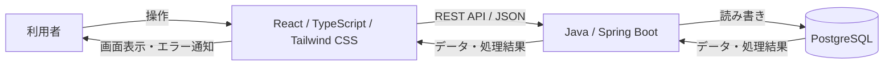

# 個人向けタスク管理アプリ 技術構成書

対象：初期版 ／ 更新日：2026年11月15日

[要件定義書に戻る](要件定義書.md)

## 1. 採用する技術スタック

初期版はReactのフロントエンド、Java / Spring Bootのバックエンド、PostgreSQLのデータベースで構成する。

| 用途 | 採用技術 | 役割・採用理由 |
|---|---|---|
| バックエンド言語 | Java | Spring BootでAPIと業務処理を実装する |
| バックエンドフレームワーク | Spring Boot | API、業務処理、DBアクセスを構成する |
| バックエンドのビルド | Gradle | Javaの依存関係とビルドを管理する |
| API | Spring Web / REST API | HTTPでJSON形式のデータをやり取りする |
| DB操作 | Spring Data JPA / Hibernate | JavaのエンティティとDBのデータを対応付ける |
| DBの変更管理 | Flyway | テーブル定義の変更をSQLで履歴管理する |
| データベース | PostgreSQL | タスク、並び順、各列のソート条件、削除確認設定を永続化する |
| フロントエンド言語 | TypeScript | 型チェックを利用して画面と操作を実装する |
| フロントエンドライブラリ | React | ボード、カード、モーダルをコンポーネントで構成する |
| フロントエンドの開発・ビルド | Vite | React / TypeScriptの開発環境とビルドに使用する |
| スタイリング | Tailwind CSS | ユーティリティクラスを使って画面の見た目を実装する |
| 画面遷移 | React Router | フロントエンドのルーティングを扱う。モーダルとURLの対応は詳細設計で決定する |
| API通信 | Fetch API | ブラウザ標準の機能でバックエンドと通信する |

主に使用する言語はJava・TypeScript・CSS・SQLとする。Reactの画面構造はTSXで記述する。Next.jsは今回の対象外とし、バックエンドのビルドにはMavenではなくGradleを使用する。スタイリングはTailwind CSSを基本とし、必要な補助スタイルは通常のCSSで記述する。

各技術の具体的なバージョン、Gradleのビルドスクリプト形式、フロントエンドのパッケージ管理ツールは未決定とし、実装準備時に互換性を確認して確定する。

## 2. システム構成とデータフロー

起動時はタスク、並び順、設定を取得する。追加・編集・削除・移動時は変更をバックエンドに送り、DBへの保存結果を画面に反映する。APIはREST形式とし、リクエスト・レスポンスはJSONで扱う。エンドポイント、データ形式の詳細、HTTPステータスとエラー形式、通信・保存失敗時の復旧方法は詳細設計で決定する。

## 3. 実装・実行時の前提

単一利用者・単一ボードを対象とし、認証や複数人での同時利用は初期版の対象外とする。対応環境・性能などの条件は[要件定義書](要件定義書.md)を、データ構造は[データベース設計書](データベース設計書.md)を参照する。

開発・動作確認はローカル環境で行う。外部ホスティング、デプロイ、外部へのデータ送信、有料サービスの利用は行わない。ローカルでの起動構成、ポート番号、フロントエンドとAPI間の接続設定は実装準備時に決定する。

## 4. 合意済みの画面プロトタイプ

[prototype/index.html](prototype/index.html)を画面仕様の参照実装とする。デモはHTML・CSS・JavaScriptのみで構成し、外部ライブラリ・外部フォント・外部通信を使用しない。localStorageでタスク、列内順序、列ごとのソート条件、削除確認設定を保持する。

HTML・CSS・JavaScriptとlocalStorageによる構成はデモ専用とする。実アプリには第1章の採用技術と第2章の構成を適用し、合意した画面仕様をReactとTailwind CSSで実装する。デモの検証メニューや保存方式と、本番の機能要件を区別する。起動方法と制限は[デモREADME](prototype/README.md)を参照する。
