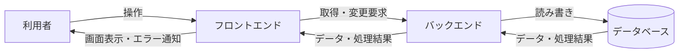

# 個人向けタスク管理アプリ 技術構成書

対象：初期版 ／ 更新日：2026年11月15日

[要件定義書に戻る](要件定義書.md)

## 1. 技術スタックの選定状況

フロントエンド・バックエンド・データベースで構成する。個別の製品やフレームワークは未選定であり、以下は採用済みの技術を示すものではない。

| 項目 | 状態 | 今後記載する内容 |
|---|---|---|
| フロントエンド | 未決定 | 言語、フレームワーク、採用理由 |
| バックエンド | 未決定 | 言語、フレームワーク、採用理由 |
| データベース | 未決定 | DB製品、採用理由 |
| 通信方式・API | 未決定 | 通信方式、API形式 |
| 実行・配置環境 | 未決定 | 設置場所、構成、公開範囲 |
| バージョン | 未決定 | 各技術の使用バージョン |

## 2. システム構成とデータフロー

起動時はタスク、並び順、設定を取得する。追加・編集・削除・移動時は変更をバックエンドに送り、DBへの保存結果を画面に反映する。APIの形式や、通信・保存失敗時の復旧方法は設計工程で決定する。

## 3. 選定時の前提

単一利用者・単一ボードを対象とし、認証や複数人での同時利用は初期版の対象外とする。対応環境・性能などの条件は[要件定義書](要件定義書.md)を、データ構造は[データベース設計書](データベース設計書.md)を参照する。

## 4. 合意済みの画面プロトタイプ

[prototype/index.html](prototype/index.html)を画面仕様の参照実装とする。デモはHTML・CSS・JavaScriptのみで構成し、外部ライブラリ・外部フォント・外部通信を使用しない。localStorageでタスク、列内順序、列ごとのソート条件、削除確認設定を保持する。

この技術構成はデモ専用であり、本番の技術選定を確定するものではない。本番では第2章のフロントエンド・バックエンド・DB構成を採用する。デモの検証メニューや保存方式と、本番の機能要件を区別する。起動方法と制限は[デモREADME](prototype/README.md)を参照する。
