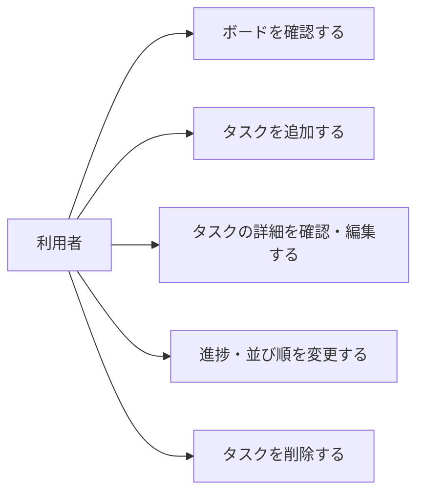
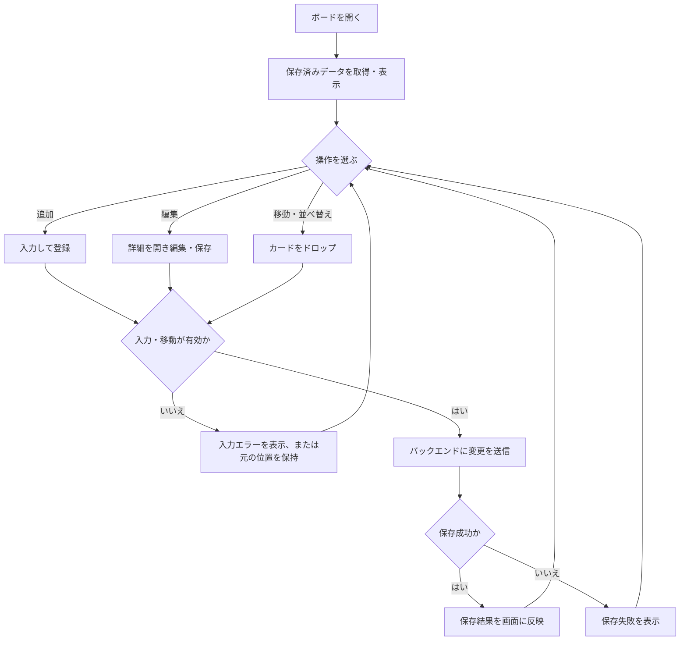
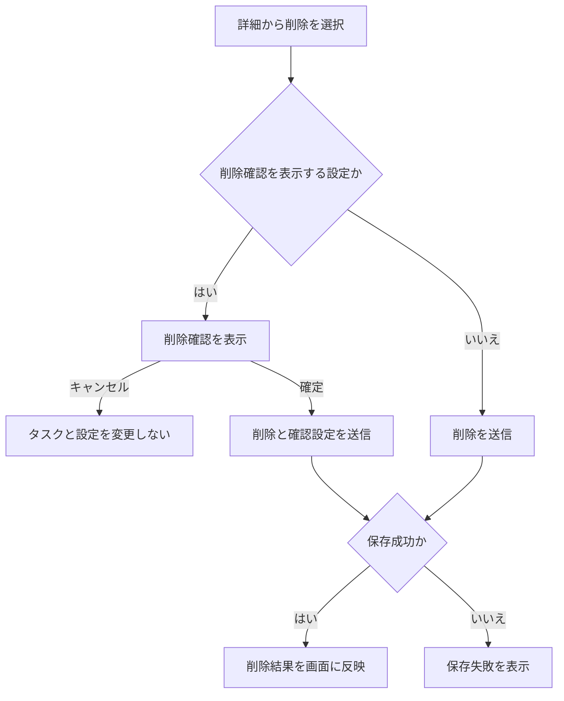

# 個人向けタスク管理アプリ 機能仕様書

対象：初期版 ／ 更新日：2026年11月14日

[要件定義書に戻る](要件定義書.md)

## 1. 機能要件

| ID | 機能 | 要件 |
|---|---|---|
| F-01 | ボード表示 | 1つのボードに「未着手」「作業中」「完了」の3列を表示する |
| F-02 | カード表示 | 各カードにタイトル、優先度、期限を表示する。期限未設定の場合は、その状態を判別できるようにする |
| F-03 | タスク追加 | タイトル、説明文、優先度、期限を入力してタスクを登録できる |
| F-04 | 詳細表示 | 登録したタスクの全項目を確認できる |
| F-05 | タスク編集 | タイトル、説明文、優先度、期限を変更できる |
| F-06 | タスク削除 | 登録済みのタスクを削除できる。確認が有効な場合は、削除前に確認画面を表示する |
| F-07 | 削除確認の省略 | 削除確認画面の「今後この確認を表示しない」チェックボックスを選択して削除を確定した場合、以後の削除確認を省略する |
| F-08 | 進捗変更 | カードを別の列へドラッグ＆ドロップすると、ステータスが変更され、移動先の列に表示される |
| F-09 | 手動並べ替え | カードをドラッグ＆ドロップして、同じ列内の並び順を変更できる。別の列へ移動する場合も、ドロップ位置に応じた順序で配置できる |
| F-10 | 自動保存 | タスクの追加・編集・削除・進捗変更・並べ替え、および削除確認を省略する設定を自動で保存する |
| F-11 | データ復元 | ページの再読み込みやブラウザの終了後も、タスクの内容、ステータス、列内の並び順、削除確認の設定を復元する |

## 2. 入力・操作のルール

### 2.1 入力と編集

- タイトルが空欄、または空白文字のみの場合は登録・更新できない。
- 説明文と期限は未入力でも登録できる。
- 入力内容に問題がある場合は、修正すべき内容を画面に表示する。
- 編集を確定した場合に変更内容を反映する。キャンセルした場合は元の内容を保持する。
- 完了したタスクも保持し、編集や他のステータスへの移動を可能にする。

### 2.2 移動と並べ替え

- 進捗変更とカードの手動並べ替えは、ドラッグ＆ドロップで操作する。
- 同じ列内での並べ替えでは、ステータスは変更しない。
- 別の列への移動では、ステータスと並び順を更新する。
- 有効な移動先にドロップされなかった場合は、元のステータスと並び順を保持する。
- 自動で並べ替えるソート機能は設けない。

### 2.3 削除と確認設定

- 初期状態では、削除前に確認画面を表示する。
- 確認画面には、削除対象を識別できる情報、削除を確定する操作、キャンセルする操作、「今後この確認を表示しない」チェックボックスを設ける。
- チェックボックスは、確認画面を表示した時点では未選択とする。
- チェックを入れずに削除を確定した場合は、そのタスクのみ削除し、次回も確認を表示する。
- チェックを入れて削除を確定した場合は、そのタスクを削除し、以後の削除確認を省略する。
- キャンセルした場合は、タスクを削除せず、確認表示の設定も変更しない。
- 確認を省略する設定は、当該アプリ全体に適用し、再起動後もデータベースに保持する。
- 確認を省略する設定が有効な場合は、削除操作によって直ちにタスクを削除する。

## 3. ユースケースと操作フロー

利用者は1人であり、ログイン操作はない。

| ユースケース | 事前条件 | 主な流れ | 操作後の状態 |
|---|---|---|---|
| ボード確認 | アプリを開ける | 保存済みデータを取得し、列とカードを表示 | 保存された状態を確認できる |
| タスク追加 | ボードを表示中 | 追加画面で入力し登録 | 未着手のタスクを保存・表示 |
| 詳細確認・編集 | 対象タスクが存在する | カードを選び、必要なら編集して保存 | 詳細を確認でき、保存成功時は変更が反映される |
| 進捗・順序変更 | 対象タスクが存在する | カードを有効な位置へドラッグ＆ドロップ | 保存成功時は移動先と順序が反映される |
| タスク削除 | 対象タスクが存在する | 削除を選び、確認が有効なら確定 | 保存成功時は対象が削除される |

### 3.1 追加・編集・移動の流れ

### 3.2 削除の流れ

確認画面で省略を選んだ場合、タスク削除と設定変更は両方成功するか、どちらも反映されないものとする。

## 4. 関連文書

- [画面設計書](画面設計書.md)：表示項目・画面遷移
- [データベース設計書](データベース設計書.md)：保存するデータの構成
- [受入条件](受入条件.md)：機能要件に対する確認内容
