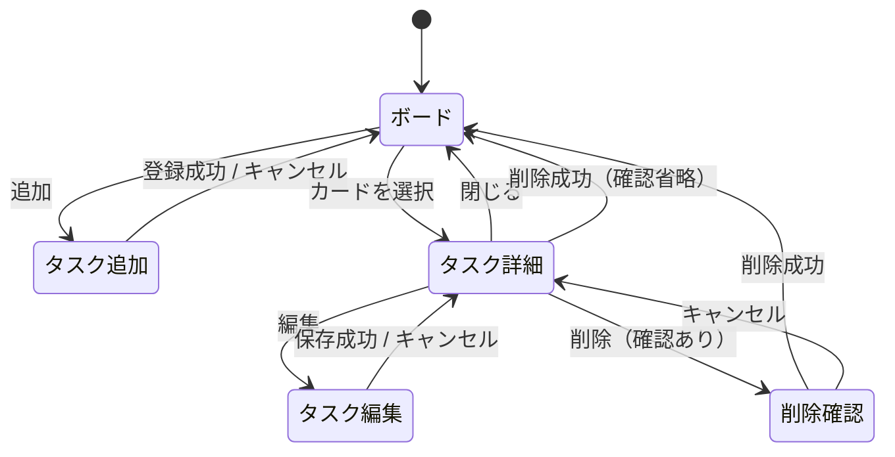

# 個人向けタスク管理アプリ 画面設計書

対象：初期版 ／ 更新日：2026年11月14日

[要件定義書に戻る](要件定義書.md)

## 1. 画面構成・画面仕様

初期版はボード画面を中心とし、追加・詳細・編集・削除確認はボード上のモーダルとして扱う。具体的な配置や文言は基本設計で決定する。

| ID | 画面・表示 | 主な表示項目 | 主な操作 |
|---|---|---|---|
| S-01 | ボード画面 | 3つの進捗列、各カードのタイトル・優先度・期限、保存・取得エラー | タスク追加、詳細表示、ドラッグ＆ドロップ |
| S-02 | タスク追加モーダル | タイトル、説明文、優先度、期限、入力エラー | 登録、キャンセル |
| S-03 | タスク詳細モーダル | タイトル、説明文、優先度、期限、ステータス | 編集、削除、閉じる |
| S-04 | タスク編集モーダル | 編集可能なタイトル、説明文、優先度、期限、入力エラー | 保存、キャンセル |
| S-05 | 削除確認モーダル | 削除対象を識別する情報、確認省略のチェック | 削除確定、キャンセル |

保存失敗時は失敗を表示する。未保存の入力内容の保持方法や再試行方法、取得失敗時の具体的な操作は基本設計で決定する。確認省略が有効な場合、削除操作から確認モーダルを経ずに削除を要求する。

### 1.1 画面遷移

登録・更新・削除に失敗した場合は対象を削除・確定済みとして扱わず、失敗を表示する。具体的な再試行手順は基本設計で定める。

## 2. 設計の状態

画面構成と遷移を整理した段階であり、ワイヤーフレーム、具体的な配置・文言、対象画面サイズ、エラー時の再試行手順は未決定とする。入力・操作のルールは[機能仕様書](機能仕様書.md)を参照する。
