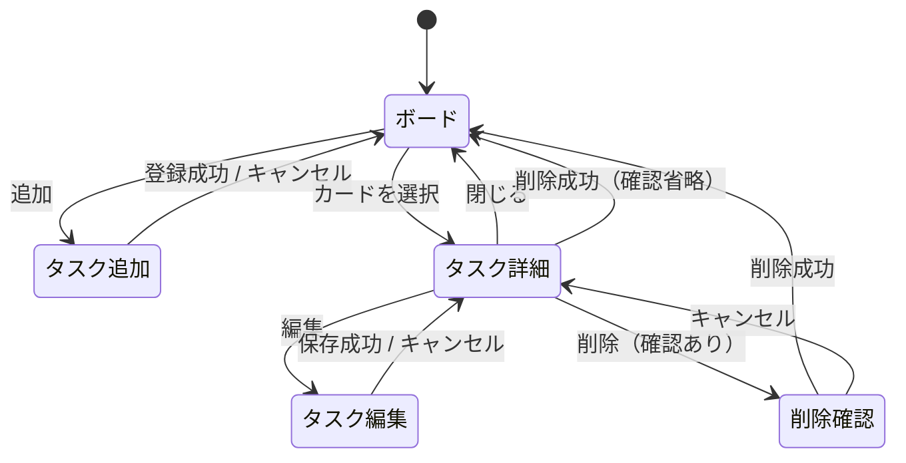

# 個人向けタスク管理アプリ 画面設計書

対象：初期版 ／ 更新日：2026年11月17日

[要件定義書に戻る](要件定義書.md)

## 現在の実装範囲（2026年11月17日）

本書は初期版全体の目標仕様を含み、すべてが実装・検証済みという意味ではない。現在はタスクREAD API、検索・閲覧、詳細モーダル、画面内の列ソートを実装済み。タスク追加のPOST APIとDB保存を実装済み。編集・削除の保存、ドラッグ操作、ソート条件と設定の永続化は未実装。実装状況と起動手順は[README](README.md)、処理の理解は[学習メモ](学習メモ.md)を参照する。

## 1. 画面構成・画面仕様

初期版はボード画面を中心とし、追加・詳細・編集・削除確認はボード上のモーダルとして扱う。2026年11月15日に利用者が確認した[画面プロトタイプ](prototype/index.html)を、画面構成・配置・配色・主要操作の合意済みの基準とする。実装ファイルの使い方は[デモREADME](prototype/README.md)を参照する。

| ID | 画面・表示 | 主な表示項目 | 主な操作 |
|---|---|---|---|
| S-01 | ボード画面 | 3つの進捗列、各カードのタイトル・優先度・期限、各列の優先度・期限の昇降順ボタン、選択中の条件と操作案内、保存・取得エラー | タスク追加、詳細表示、表示順切り替え、ドラッグ＆ドロップ |
| S-02 | タスク追加モーダル | タイトル、説明文、優先度、期限、入力エラー | 登録、キャンセル |
| S-03 | タスク詳細モーダル | タイトル、説明文、優先度、期限、ステータス | 編集、削除、閉じる |
| S-04 | タスク編集モーダル | 編集可能なタイトル、説明文、優先度、期限、入力エラー | 保存、キャンセル |
| S-05 | 削除確認モーダル | 削除対象を識別する情報、確認省略のチェック | 削除確定、キャンセル |

保存失敗時はエラーを表示し、追加・編集フォームの入力を維持して再実行できるようにする。取得失敗時はエラーと「再取得」を表示する。確認省略が有効な場合、削除操作から確認モーダルを経ずに削除を要求する。

### 1.1 画面遷移

登録・更新・削除に失敗した場合は対象を削除・確定済みとして扱わず、失敗を表示し、対象モーダルに留まる。入力内容を維持したまま同じ確定ボタンで再試行できる。移動・ソートの保存失敗時は元の配置・条件を維持する。

## 2. 設計の状態

画面構成・基本配置・配色・主要操作・エラー時の表示と再試行はデモを基準として合意済みとする。最低対応画面サイズ、Chromeの対象バージョン、追加・編集フォームの入力制限は今後確定する（DBのタイトル上限は255文字で実装済み）。入力・操作のルールは[機能仕様書](機能仕様書.md)を参照する。実アプリはReact / TypeScriptとTailwind CSSで実装する。採用技術は[技術構成書](技術構成書.md)を参照する。デモによる確認と、実アプリでのAPI通信・PostgreSQLへの保存の検証は区別する。

## 3. 列ごとの並べ替え

「未着手」「作業中」「完了」の各見出し下に、優先度と期限それぞれの昇順／降順ボタン（1列あたり4ボタン）を配置する。全体の表示順欄と手動順ボタンは設けない。選択中のボタンは色とaria-pressedで示す。

優先度は昇順で低→中→高、降順で高→中→低。期限は昇順で近い順、降順で遠い順とし、期限なしはどちらも最後。同順位は直前の順序を保つ。各列に選択中の条件の説明を表示する。

各列で独立してソートでき、初期状態は未選択。ドラッグ操作も継続して利用でき、実際の移動時には関係する列のソート条件を解除してドロップ位置を保持する。詳細は[機能仕様書](機能仕様書.md)のF-12を参照する。

## 4. 合意したレイアウトと表示

| 領域 | 仕様 |
|---|---|
| ヘッダー | アプリ名「Task Board」を左に配置する。PROTOTYPE表記はデモ専用 |
| ボード上部 | 見出し「マイタスク」、説明、右側の「＋ タスクを追加」、タスク総数・完了数、保存状態を表示する |
| 進捗列 | 左から未着手・作業中・完了の順に3列を並べ、列名・件数・説明・ソートボタンを配置する |
| カード | 優先度、タイトル、期限の順に表示する。長いタイトルは折り返し、期限未設定は「期限なし」とする |
| 配色 | 白いカードと淡いグレーの背景、グリーンの主要ボタン。優先度は高・中・低を色と文字の両方で表示する |
| 期限超過 | 未着手・作業中のカードでは、今日より前の期限を強調する。完了列では強調しない |
| 空の列 | 列とソートボタンを残し、「まだタスクはありません」と移動の案内を表示する |
| 狭い画面 | 3列の構造を維持してボードを横スクロールする。スマートフォン向けの最適化は対象外 |

## 5. モーダルの表示と操作

- モーダルは背景にボードを残して中央に表示する。高さが画面を超える場合はモーダル内をスクロールする。
- 追加・編集はタイトル、複数行の説明文、その下に優先度と期限を配置する。必須・任意を明示し、操作ボタンを下部に配置する。
- 新規タスクは優先度「中」、期限なし、ステータス「未着手」。未着手の末尾へ追加し、列のソート条件があれば適用する。
- 詳細にはタイトル、ステータス、優先度、期限、説明文を表示し、下部に削除・閉じる・編集を配置する。
- 削除確認には対象タイトル、元に戻せない旨、確認省略のチェックボックス、キャンセル・削除を表示する。
- 追加のキャンセルはボードへ、編集の保存・キャンセルは詳細へ、削除確認のキャンセルは詳細へ戻る。
- 閉じるボタンとEscapeはそのモーダルのキャンセル操作と同じ戻り先にする。Tabでモーダル内を操作し、終了後は元のカードまたは追加ボタンへフォーカスを戻す。

## 6. デモ専用機能と本番の境界

デモ確認メニューのサンプル復帰・空ボード・保存失敗・取得失敗・削除確認の再有効化は検証専用とし、本番画面にはそのまま追加しない。削除確認の再有効化を本番に設けるかは未決定とする。

デモはlocalStorageに保存する。本番ではバックエンド・DBを使用し、保存成功後の表示反映と失敗時の入力・配置保持という操作上の挙動を引き継ぐ。

## 7. 現在の検索・閲覧画面との対応

実アプリはデモの配置・配色を引き継ぐ。見出し右の追加ボタンでフォームを表示しPOST APIで登録する。詳細モーダルの編集・削除は無効とする。削除確認・編集モーダルとドラッグ操作は未実装。

ボード下に折りたたみの検索欄を配置し、適用中の条件と件数を表示する。ボード上部の状態表示は現在「取得中・取得済み・取得失敗」と再取得操作であり、デモのlocalStorage保存状態ではない。取得失敗時は各列の件数を「—」とし、正常な0件と区別する。列ソートは画面内のみで保持し、再読み込みで解除する。
