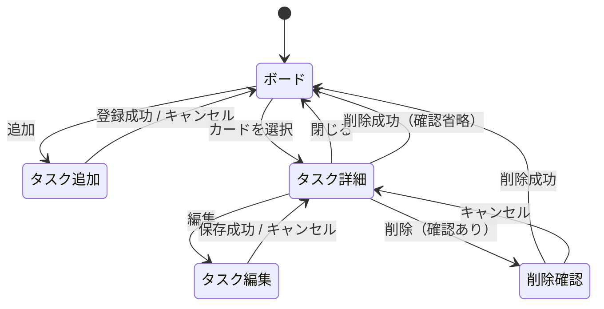
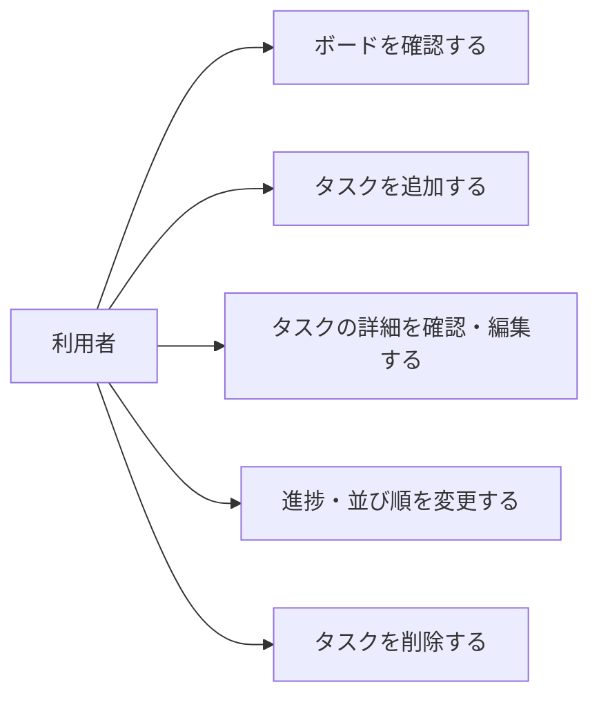
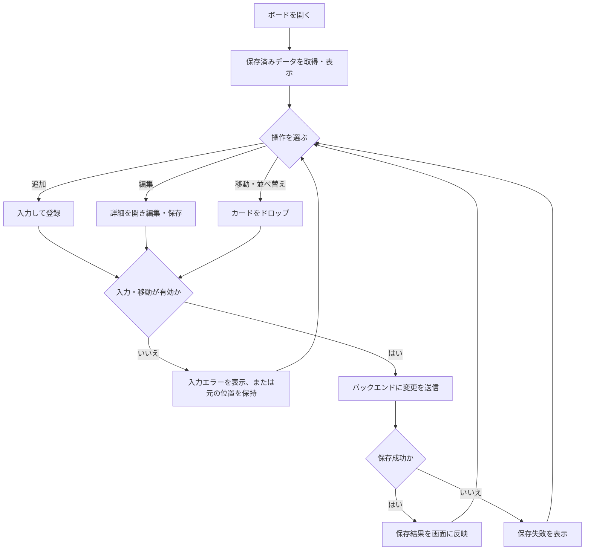
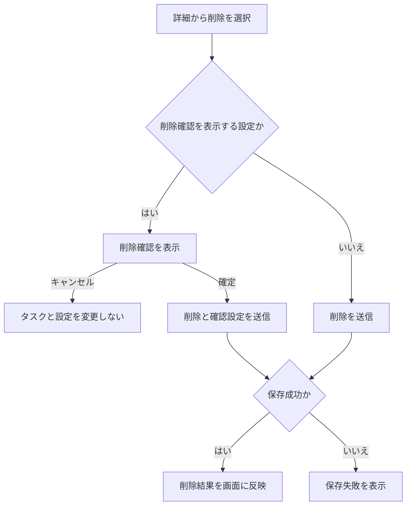
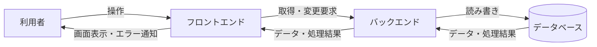
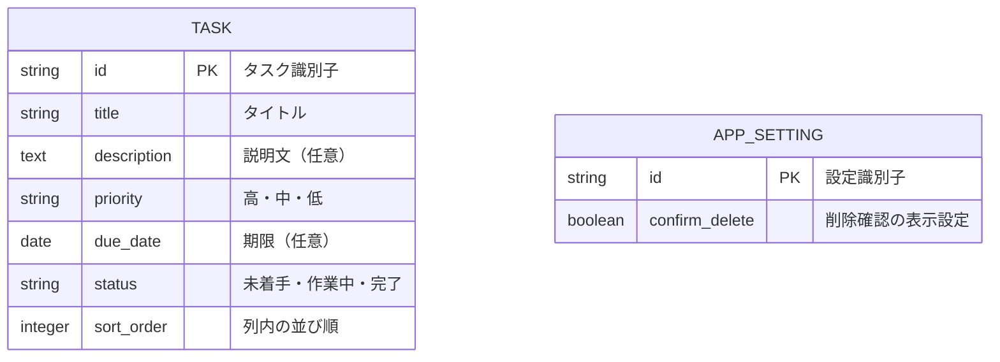

# 個人向けタスク管理アプリ 要件定義書

| 項目 | 内容 |
|---|---|
| 文書バージョン | 0.3 |
| 作成日 | 2026年11月10日 |
| 文書の状態 | 決定事項を反映した初版。未決定事項は第11章に記載 |
| 対象 | 初期版 |

## 1. 開発の背景と目的

講座の課題として、画面設計からバックエンド・データベースを含むWebアプリ開発までの流れを学ぶ。

題材として、個人が抱えるタスクの内容、優先度、期限、進捗を一か所で管理できるアプリを開発する。

Trelloのようにタスクをカード形式で表示し、進捗別の列に分けることで、現在の作業状況を視覚的に把握できるWebアプリを開発する。

## 2. 想定利用者・利用環境

| 項目 | 内容 |
|---|---|
| 想定利用者 | 自分のタスクを管理したい個人 |
| 利用人数 | 1人 |
| 利用形態 | Webブラウザから利用 |
| 対応端末 | 初期版はPCを中心とする。スマートフォンへの対応は将来の拡張とする |
| 対応ブラウザ | 初期版はGoogle Chromeとする。対象バージョンは別途決定する |
| 管理単位 | 1つのボード |
| データの扱い | バックエンドを通じてデータベースに保存し、次回利用時に取得する |

## 3. 開発対象の範囲

### 3.1 初期版で提供する機能

- 1つのボードにおけるタスクの進捗別表示
- タスクの追加・詳細表示・編集・削除
- ドラッグ＆ドロップによる進捗変更
- ドラッグ＆ドロップによるカードの手動並べ替え
- 削除前の確認と、以後の確認表示を省略する設定
- タスクデータ、カードの並び順、削除確認の設定の保存と復元

### 3.2 初期版の対象外

- アカウント登録・ログイン
- チームでの共有、担当者の設定
- 通知・リマインダー
- 複数人による同時利用やユーザーごとのデータ分離
- 複数ボードの作成・切り替え
- 作成順、優先度順、期限順などのソート機能
- スマートフォン向けの操作・表示の最適化

## 4. 基本的な利用の流れ

1. アプリを開き、保存済みのタスクを確認する。
2. タイトル、説明文、優先度、期限を入力してタスクを登録する。
3. 必要に応じてタスクの内容を編集する。
4. カードをドラッグ＆ドロップし、進捗や列内の並び順を変更する。
5. 作業が終わったタスクを「完了」列に移動する。
6. 不要なタスクを削除する。確認が有効な場合は、確認画面で削除を確定する。

操作による変更内容はバックエンドを通じて自動で保存され、次回アプリを開いた際に取得される。

## 5. 機能要件

| ID | 機能 | 要件 |
|---|---|---|
| F-01 | ボード表示 | 1つのボードに「未着手」「作業中」「完了」の3列を表示する |
| F-02 | カード表示 | 各カードにタイトル、優先度、期限を表示する。期限未設定の場合は、その状態を判別できるようにする |
| F-03 | タスク追加 | タイトル、説明文、優先度、期限を入力してタスクを登録できる |
| F-04 | 詳細表示 | 登録したタスクの全項目を確認できる |
| F-05 | タスク編集 | タイトル、説明文、優先度、期限を変更できる |
| F-06 | タスク削除 | 登録済みのタスクを削除できる。確認が有効な場合は、削除前に確認画面を表示する |
| F-07 | 削除確認の省略 | 削除確認画面の「今後この確認を表示しない」チェックボックスを選択して削除を確定した場合、以後の削除確認を省略する |
| F-08 | 進捗変更 | カードを別の列へドラッグ＆ドロップすると、ステータスが変更され、移動先の列に表示される |
| F-09 | 手動並べ替え | カードをドラッグ＆ドロップして、同じ列内の並び順を変更できる。別の列へ移動する場合も、ドロップ位置に応じた順序で配置できる |
| F-10 | 自動保存 | タスクの追加・編集・削除・進捗変更・並べ替え、および削除確認を省略する設定を自動で保存する |
| F-11 | データ復元 | ページの再読み込みやブラウザの終了後も、タスクの内容、ステータス、列内の並び順、削除確認の設定を復元する |

## 6. データ要件

### 6.1 タスクの項目

| 項目 | 内容 | 必須・初期値 |
|---|---|---|
| タイトル | タスクの名前 | 必須 |
| 説明文 | タスクの詳細。複数行の入力に対応する | 任意 |
| 優先度 | 高・中・低の3段階 | 必須。初期値は「中」 |
| 期限 | タスクの完了予定日。時刻は扱わない | 任意 |
| ステータス | 未着手・作業中・完了 | 必須。初期値は「未着手」 |

### 6.2 保存する管理情報

- 各列におけるカードの並び順
- 削除確認を表示するかどうかの設定。初期状態では確認を表示する

タスクを識別する情報と並び順を保持する。具体的な型や制約は詳細設計で決定する。

## 7. 入力・操作のルール

### 7.1 入力と編集

- タイトルが空欄、または空白文字のみの場合は登録・更新できない。
- 説明文と期限は未入力でも登録できる。
- 入力内容に問題がある場合は、修正すべき内容を画面に表示する。
- 編集を確定した場合に変更内容を反映する。キャンセルした場合は元の内容を保持する。
- 完了したタスクも保持し、編集や他のステータスへの移動を可能にする。

### 7.2 移動と並べ替え

- 進捗変更とカードの手動並べ替えは、ドラッグ＆ドロップで操作する。
- 同じ列内での並べ替えでは、ステータスは変更しない。
- 別の列への移動では、ステータスと並び順を更新する。
- 有効な移動先にドロップされなかった場合は、元のステータスと並び順を保持する。
- 自動で並べ替えるソート機能は設けない。

### 7.3 削除と確認設定

- 初期状態では、削除前に確認画面を表示する。
- 確認画面には、削除対象を識別できる情報、削除を確定する操作、キャンセルする操作、「今後この確認を表示しない」チェックボックスを設ける。
- チェックボックスは、確認画面を表示した時点では未選択とする。
- チェックを入れずに削除を確定した場合は、そのタスクのみ削除し、次回も確認を表示する。
- チェックを入れて削除を確定した場合は、そのタスクを削除し、以後の削除確認を省略する。
- キャンセルした場合は、タスクを削除せず、確認表示の設定も変更しない。
- 確認を省略する設定は、当該アプリ全体に適用し、再起動後もデータベースに保持する。
- 確認を省略する設定が有効な場合は、削除操作によって直ちにタスクを削除する。

## 8. 非機能要件

| 分類 | 要件 |
|---|---|
| 操作性 | PCのChrome上で、タスクの追加、編集、削除、ドラッグ＆ドロップによる移動・並べ替えを操作できる |
| 視認性 | ステータスと優先度を判別できる。色を使用する場合も文字などで意味を確認できる |
| データ保持 | データベースに保存された内容を、ブラウザやアプリを終了しても保持する |
| 保存失敗への対応 | データの保存に失敗した場合は、利用者に分かるように表示する |
| 対応環境 | 初期版の対応ブラウザはChromeとし、対象バージョンとPCの画面サイズは別途決定する |
| 性能 | 想定するタスク件数と応答時間の目標は別途決定する |

## 9. 前提・制約

- 単一利用者向けとし、アカウント登録・ログイン・ユーザーごとのデータ分離は行わない。
- フロントエンドはバックエンドを通じてデータを読み書きし、バックエンドはデータベースに保存する。
- DB製品、設置場所、通信方式および公開範囲は設計工程で決定する。
- 同じバックエンドに接続する端末・ブラウザは同じデータを参照する。複数人による同時利用や競合の解決は初期版の対象外とする。
- バックアップ・復元機能の初期版での扱いは未決定とする。

## 10. 受入条件

以下を満たした場合、初期版の主要要件を満たしたものとする。未決定事項に関連する条件は、要件確定時に追記する。

| ID | 確認内容 | 関連要件 |
|---|---|---|
| A-01 | PCのChromeでアプリを開くと、1つのボードに3つの進捗列が表示される | F-01 |
| A-02 | タイトルのみの入力でタスクを登録でき、優先度は「中」、ステータスは「未着手」になる | F-03 |
| A-03 | タイトルが空欄または空白文字のみの場合、登録・更新ができず理由が表示される | F-03、F-05 |
| A-04 | カードにタイトル、優先度、期限の有無が表示され、詳細表示で全項目を確認できる | F-02、F-04 |
| A-05 | 説明文、優先度、期限、タイトルを編集でき、キャンセル時は変更されない | F-05 |
| A-06 | カードを別の列へドラッグ＆ドロップすると、ステータスが変わり、指定した位置に表示される | F-08、F-09 |
| A-07 | 同じ列内でカードをドラッグ＆ドロップすると、ステータスを保持したまま並び順が変わる | F-09 |
| A-08 | 無効な場所にドロップした場合、元のステータスと並び順が保持される | F-08、F-09 |
| A-09 | 初期状態では削除確認が表示され、キャンセルするとタスクも設定も変更されない | F-06、F-07 |
| A-10 | チェックを入れずに削除を確定すると対象タスクが削除され、次回も確認が表示される | F-06、F-07 |
| A-11 | 「今後この確認を表示しない」にチェックを入れて削除を確定すると、以後の削除確認が省略される | F-07 |
| A-12 | ページの再読み込み後も、タスクの内容、ステータス、並び順、削除確認の設定が保持され、削除済みタスクは復元されない | F-10、F-11 |
| A-13 | ブラウザを終了し、同じ環境で開き直しても、保存内容が復元される | F-11 |
| A-14 | 保存に失敗した場合、利用者に保存失敗が表示される | F-10、非機能要件 |

## 11. 今後決める事項

| 項目 | 決める内容 |
|---|---|
| 入力上限 | タイトル・説明文の最大文字数 |
| 想定データ量と性能 | 想定するタスク件数と応答時間の目標 |
| Chromeの対象バージョン | 動作確認・動作保証の対象範囲 |
| PCの対象画面サイズ | 最低限対応する画面幅・高さ |
| 新規カードの追加位置 | 「未着手」列の先頭・末尾のいずれに追加するか |
| 削除確認の再有効化 | 確認を省略した後、再び表示するための操作を初期版に設けるか |
| バックアップ・復元 | データの書き出し・読み込みを初期版に含めるか |

## 12. 後続工程

要件定義後は、以下の順序で進める。

1. **基本設計**：画面構成、操作の流れ、画面上の表示や確認方法を決定する。
2. **詳細設計**：データ構造、処理の流れ、保存方式、エラー処理を決定する。
3. **実装**：確定した設計に沿ってアプリを作成する。
4. **テスト**：受入条件をもとに、各機能と保存・復元を確認する。

技術の選定、具体的な画面配置、入力値の詳細な検証ルールは、設計工程で決定する。

## 13. 画面構成・画面仕様

初期版はボード画面を中心とし、追加・詳細・編集・削除確認はボード上のモーダルとして扱う。具体的な配置や文言は基本設計で決定する。

| ID | 画面・表示 | 主な表示項目 | 主な操作 |
|---|---|---|---|
| S-01 | ボード画面 | 3つの進捗列、各カードのタイトル・優先度・期限、保存・取得エラー | タスク追加、詳細表示、ドラッグ＆ドロップ |
| S-02 | タスク追加モーダル | タイトル、説明文、優先度、期限、入力エラー | 登録、キャンセル |
| S-03 | タスク詳細モーダル | タイトル、説明文、優先度、期限、ステータス | 編集、削除、閉じる |
| S-04 | タスク編集モーダル | 編集可能なタイトル、説明文、優先度、期限、入力エラー | 保存、キャンセル |
| S-05 | 削除確認モーダル | 削除対象を識別する情報、確認省略のチェック | 削除確定、キャンセル |

保存失敗時は失敗を表示する。未保存の入力内容の保持方法や再試行方法、取得失敗時の具体的な操作は基本設計で決定する。確認省略が有効な場合、削除操作から確認モーダルを経ずに削除を要求する。

### 13.1 画面遷移

登録・更新・削除に失敗した場合は対象を削除・確定済みとして扱わず、失敗を表示する。具体的な再試行手順は基本設計で定める。

## 14. ユースケースと操作フロー

利用者は1人であり、ログイン操作はない。

| ユースケース | 事前条件 | 主な流れ | 操作後の状態 |
|---|---|---|---|
| ボード確認 | アプリを開ける | 保存済みデータを取得し、列とカードを表示 | 保存された状態を確認できる |
| タスク追加 | ボードを表示中 | 追加画面で入力し登録 | 未着手のタスクを保存・表示 |
| 詳細確認・編集 | 対象タスクが存在する | カードを選び、必要なら編集して保存 | 詳細を確認でき、保存成功時は変更が反映される |
| 進捗・順序変更 | 対象タスクが存在する | カードを有効な位置へドラッグ＆ドロップ | 保存成功時は移動先と順序が反映される |
| タスク削除 | 対象タスクが存在する | 削除を選び、確認が有効なら確定 | 保存成功時は対象が削除される |

### 14.1 追加・編集・移動の流れ

### 14.2 削除の流れ

確認画面で省略を選んだ場合、タスク削除と設定変更は両方成功するか、どちらも反映されないものとする。

## 15. データ構成と処理の流れ

### 15.1 構成とデータフロー

起動時はタスク、並び順、設定を取得する。追加・編集・削除・移動時は変更をバックエンドに送り、DBへの保存結果を画面に反映する。APIの形式や、通信・保存失敗時の復旧方法は設計工程で決定する。

### 15.2 ER図

単一ボード・単一利用者のため、ボードやユーザーのエンティティは設けない。TASKとAPP_SETTINGの間に直接の関連はない。設定はアプリ全体で1件とし、confirm_deleteの初期値は真とする。各タスクのstatusとsort_orderで列と列内順序を表す。属性の型・順序の管理方法・制約は論理的な表現であり、DB製品に合わせて詳細設計で確定する。
